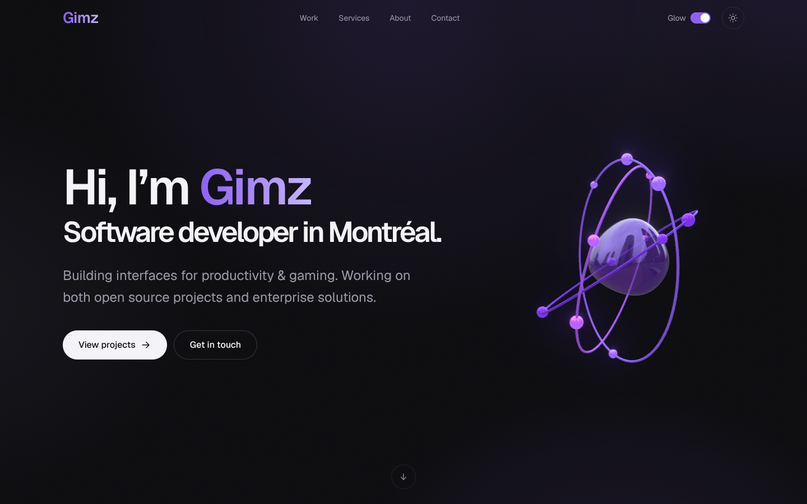
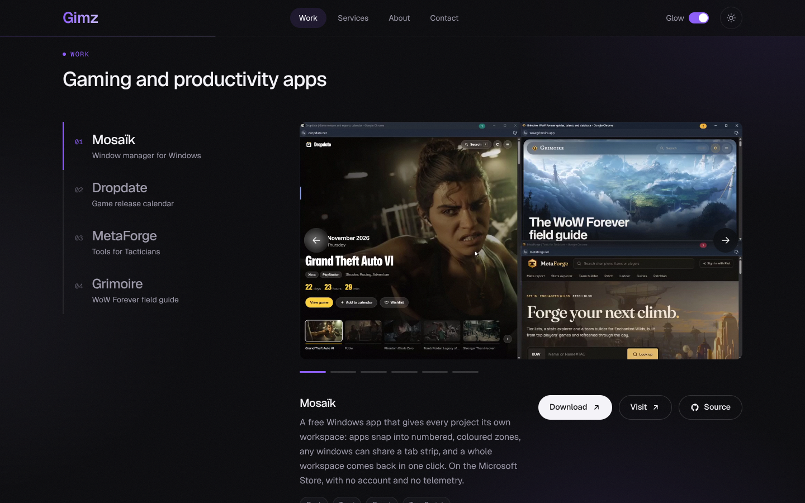
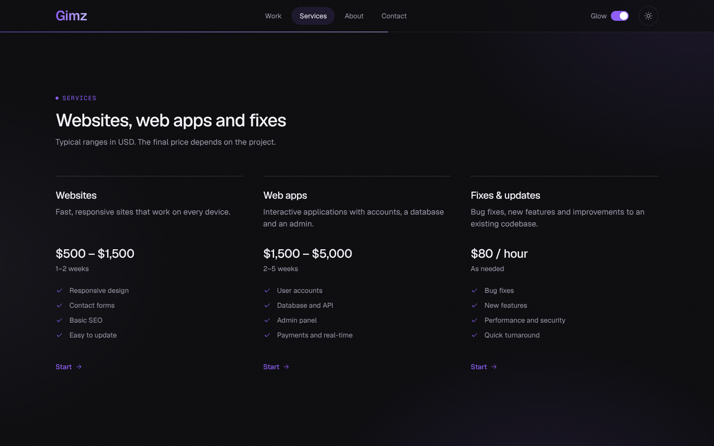
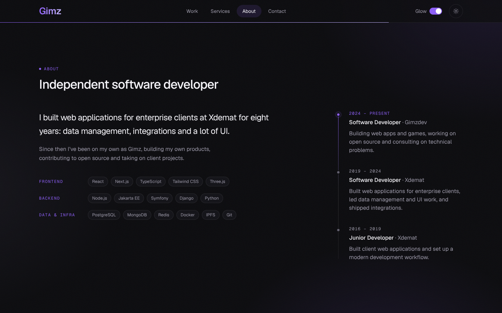

# Gimzdev

Portfolio site and project index.

[gimzdev.com](https://gimzdev.com) · Next.js · TypeScript · Tailwind CSS · Three.js

<table>
<tr>
<td align="center" width="50%"> Hero</td>
<td align="center" width="50%"> Work</td>
</tr>
<tr>
<td align="center" width="50%"> Services</td>
<td align="center" width="50%"> About</td>
</tr>
</table>

This is my portfolio and the index of everything I build. It shows the projects with screenshots and
links, what I can do for a client and roughly what it costs, and who I am. I make web apps and games, and
take on consulting and fixes for existing codebases.

| | |
|:---|:---|
| **Work** | MetaForge, Mosaïk, Dropdate and Grimoire, with screenshots and links |
| **Services** | Websites, web apps, fixes and updates, with typical prices and timelines |
| **About** | Background, skills and a career timeline |
| **Contact** | A message form, email, GitHub, X and Discord |

The page has a 3D hero, a cursor glow and light and dark themes. The contact form sends mail over SMTP,
with the server and credentials kept out of the repository.

