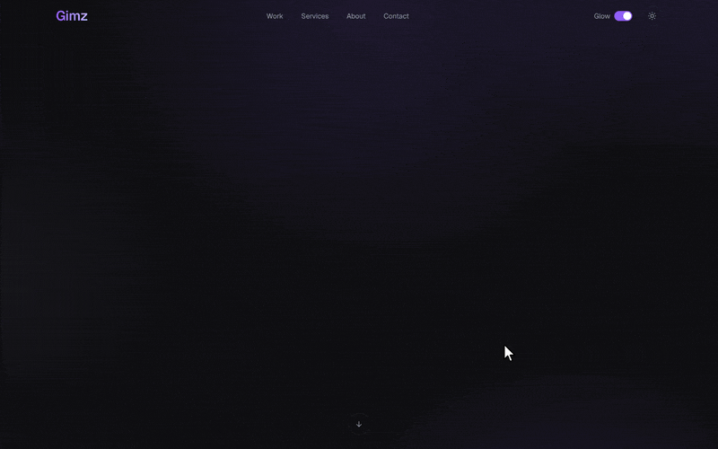
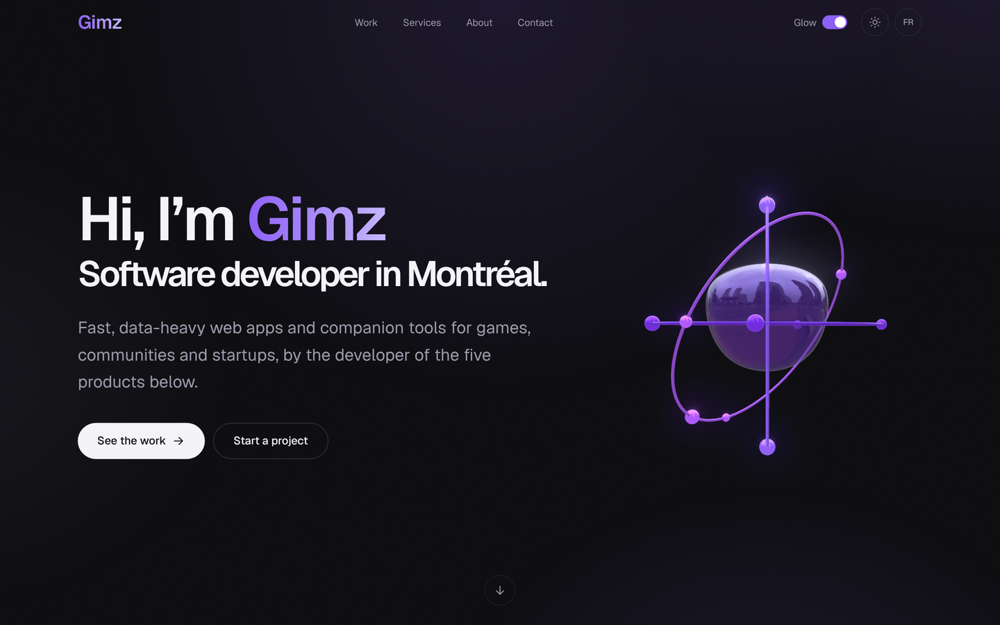
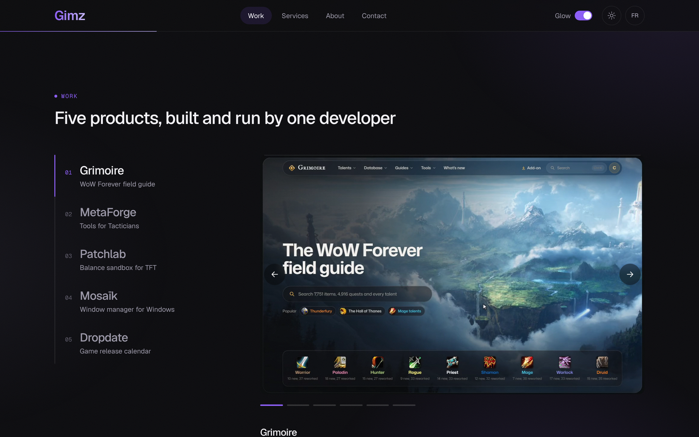
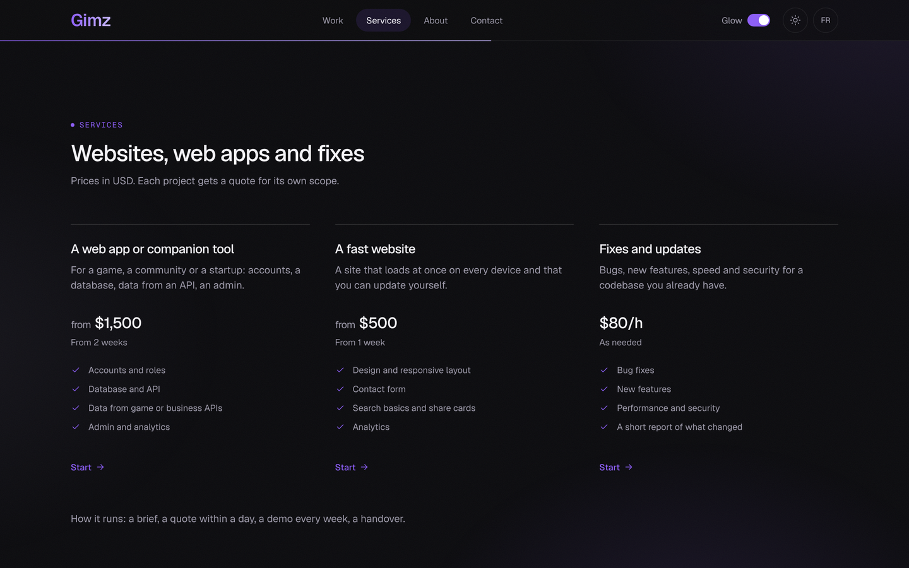
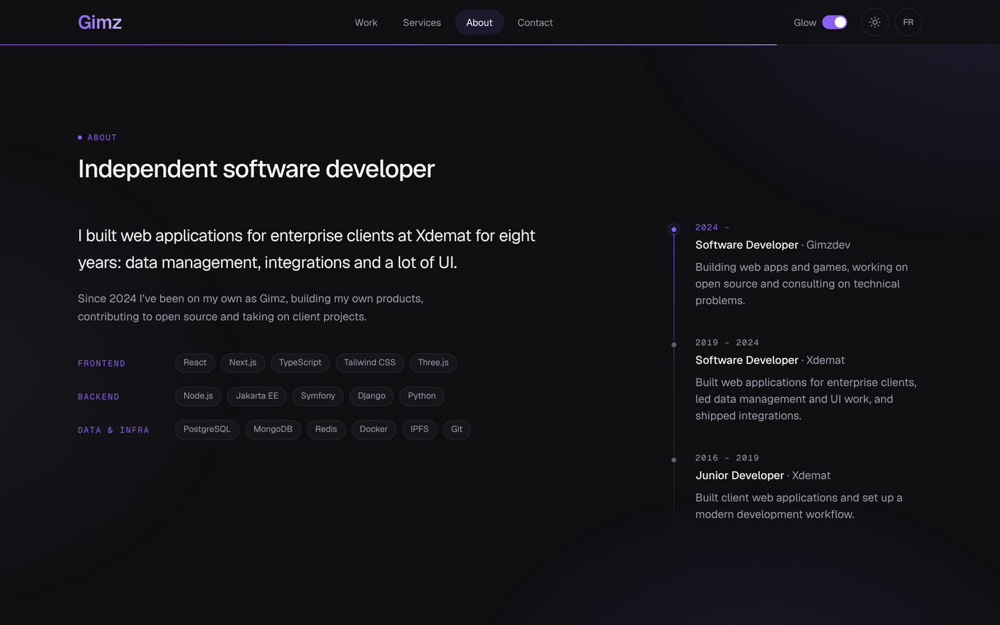

# Gimzdev

Portfolio and client-work site: case studies, services and prices, in English and French.

[gimzdev.com](https://gimzdev.com) · Next.js · TypeScript · Tailwind CSS · Three.js

<table>
<tr>
<td align="center" width="50%"> Hero</td>
<td align="center" width="50%"> Work</td>
</tr>
<tr>
<td align="center" width="50%"> Services</td>
<td align="center" width="50%"> About</td>
</tr>
</table>

This is my portfolio and where client work starts. It shows the five products I build and run, each with a
case study, what I can build for a client with a "from" price, and who I am, in English and in Québec French.

| | |
|:---|:---|
| **Work** | Grimoire, MetaForge, Patchlab, Mosaïk and Dropdate, each with a clip, screenshots and a case study at `/work/<id>` with numbers and their source |
| **Services** | A web app or companion tool, a fast website, fixes and updates, each with a "from" price and its own page at `/services/<slug>` |
| **Français** | The whole site in Québec French at `/fr`, with hreflang both ways |
| **Support** | `/support`: what support pays for, and the products it keeps free |
| **Contact** | A message form with optional budget and timeline, email, GitHub, X and Discord |

The page has a 3D hero, a cursor glow and light and dark themes. The contact form sends mail over SMTP,
with the server and credentials kept out of the repository.

