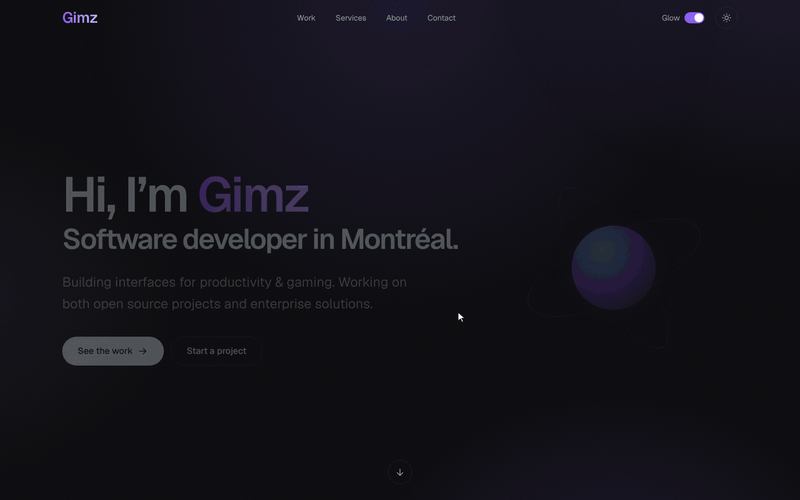
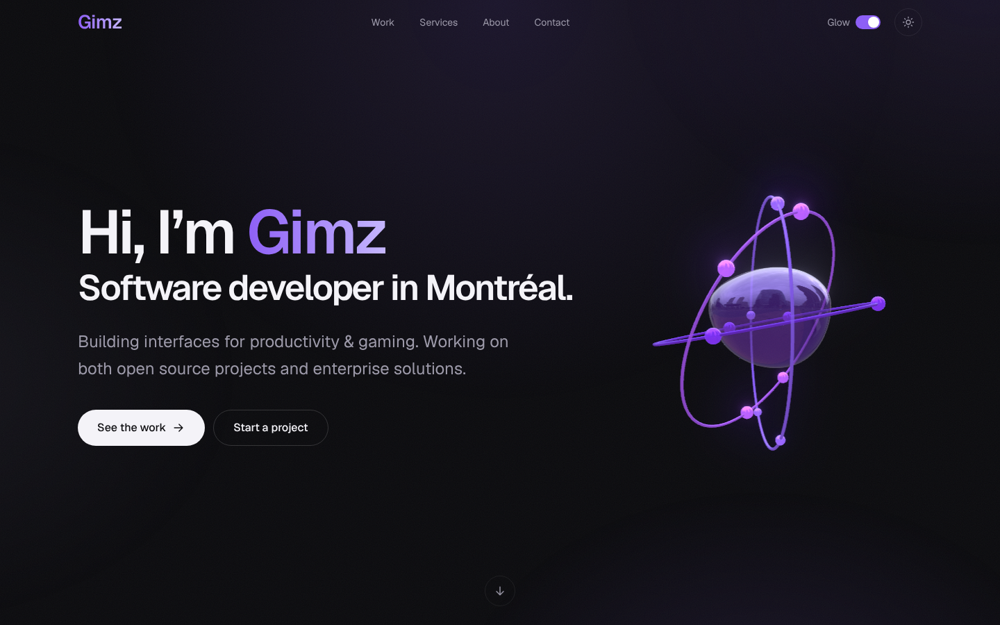
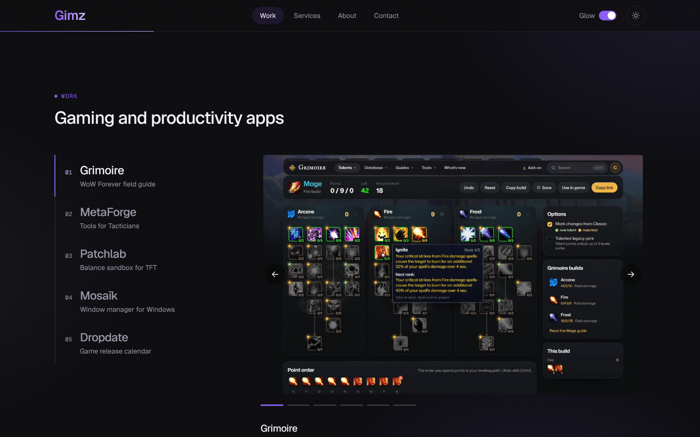
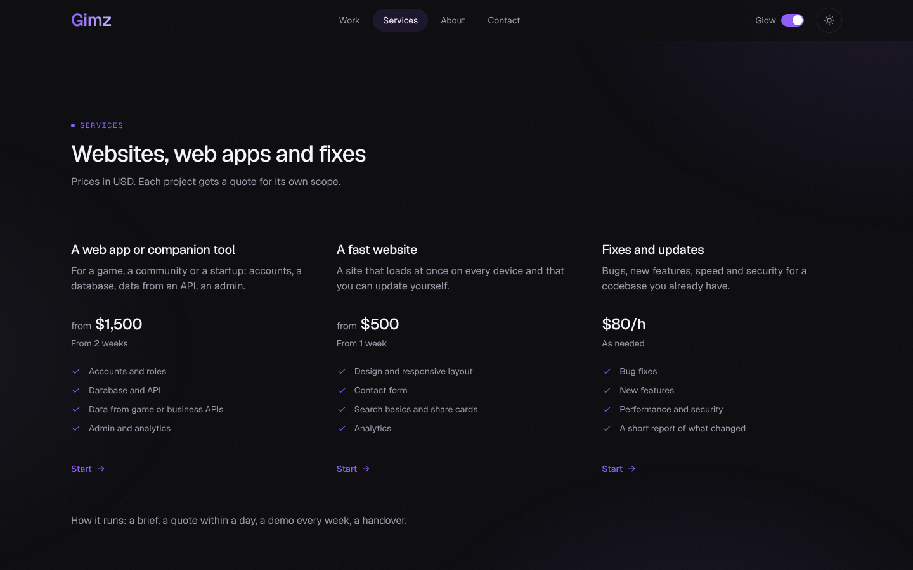
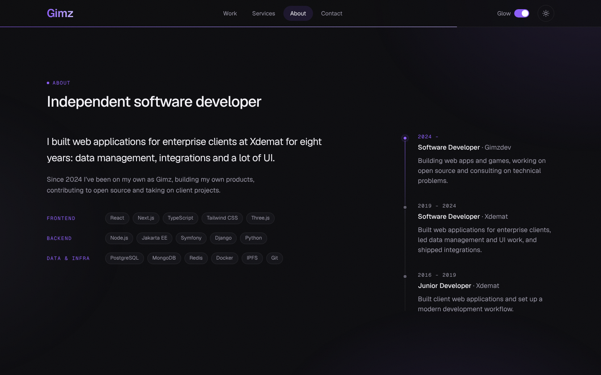

<h1 align="center">Gimzdev</h1>

<p align="center">Portfolio</p>

<p align="center"><b><a href="https://www.gimzdev.com">gimzdev.com</a></b></p>

<p align="center"></p>

The site at [gimzdev.com](https://www.gimzdev.com): the projects with a case study each, the services and a
contact form.

## Features

- **Work.** Grimoire, MetaForge, Patchlab, Mosaïk and Dropdate, each with a clip, screenshots and a case study at `/work/<id>`.
- **Services.** A web app or companion tool, a fast website, fixes and updates, each with a starting price and a page at `/services/<slug>`.
- **Contact.** A message form with optional budget and timeline, and email, GitHub, X and Discord beside it.
- **Support.** `/support` says what support pays for.

<p align="center">   </p>

## Built with

Next.js (App Router), React, TypeScript, Tailwind CSS and three.js. No CMS and no database: the content is in one
file, `lib/content.ts`.

<details>
<summary>Implementation notes</summary>

- **Hero orb.** Plain three.js, with no React wrapper: a glass core displaced on the GPU, three rings of glowing nodes, HDR lighting and bloom. It leans toward the pointer on a critically damped spring and spins like a trackball when dragged.
- **Rendering.** three.js is its own chunk, loaded once the page is interactive, and the orb renders only while it is on screen and motion is allowed.
- **Contact form.** A server action. Its rules are shared by the browser and the server, a hidden checkbox catches bots, a visitor gets five messages an hour, and short SMTP timeouts make a stuck mail server fail in seconds.
- **Pictures.** Screenshots and clips keep their names when they are replaced, so they are served with `must-revalidate`.

</details>

## Run it

```bash
git clone https://github.com/gimzdev/portfolio.git
cd portfolio
npm ci
npm run dev        # http://localhost:3000
```

Node.js 20.9 or newer. The contact form needs SMTP settings: copy `.env.example` to `.env.local` and fill it in. The
rest of the site runs without it. `npm run typecheck` and `npm run build` check and build it.

This repository is written by one script, which also installs and deploys the site, and is pushed after each deploy.

## Licence and credits

Public domain under [CC0 1.0](LICENSE). The orb's lighting is `potsdamer_platz_1k.hdr` from
[pmndrs/drei-assets](https://github.com/pmndrs/drei-assets). The clips and screenshots in `public/media/` show the
projects; the game names and art in them belong to their owners.

<p align="center"><sub><a href="https://www.gimzdev.com/?utm_source=github">Gimz</a> · <a href="https://github.com/gimzdev/grimoire">Grimoire</a> · <a href="https://github.com/gimzdev/metaforge">MetaForge</a> · <a href="https://github.com/gimzdev/patchlab">Patchlab</a> · <a href="https://github.com/gimzdev/mosaik">Mosaïk</a> · <a href="https://github.com/gimzdev/dropdate">Dropdate</a></sub></p>
